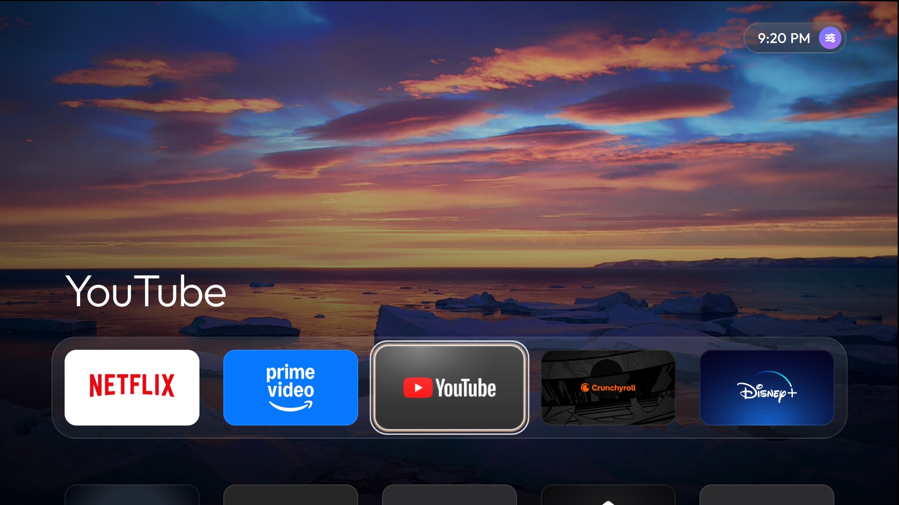
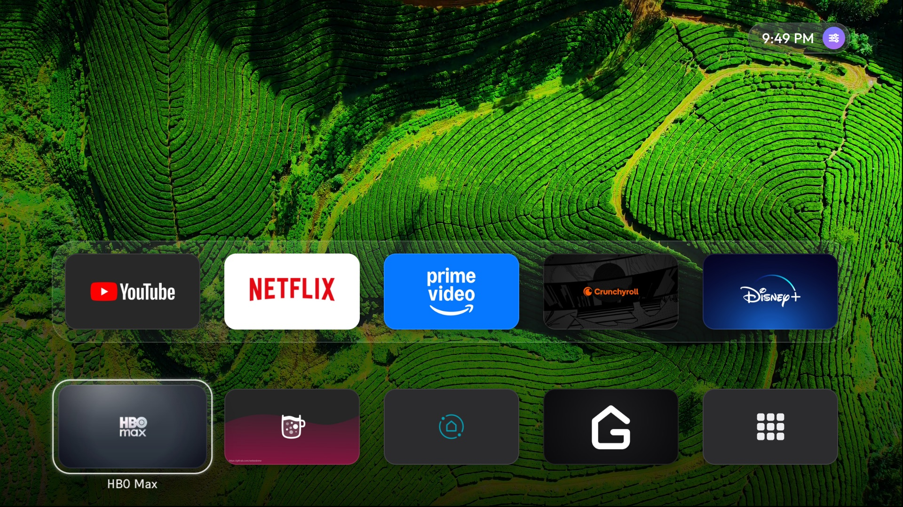
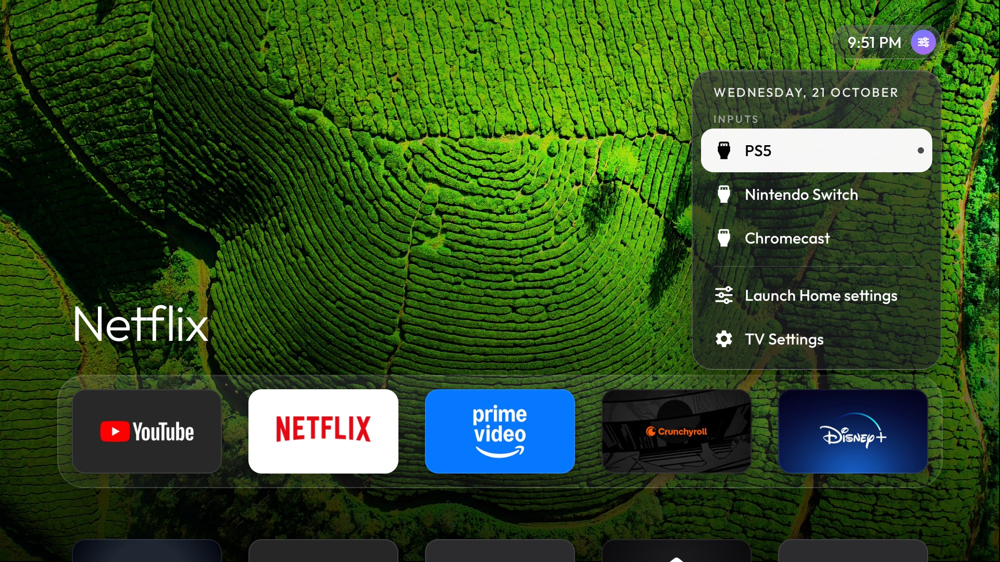
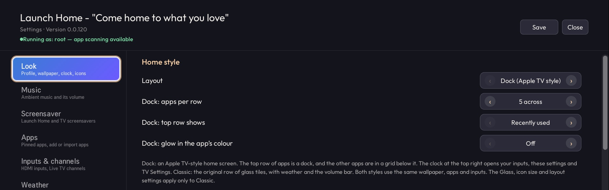
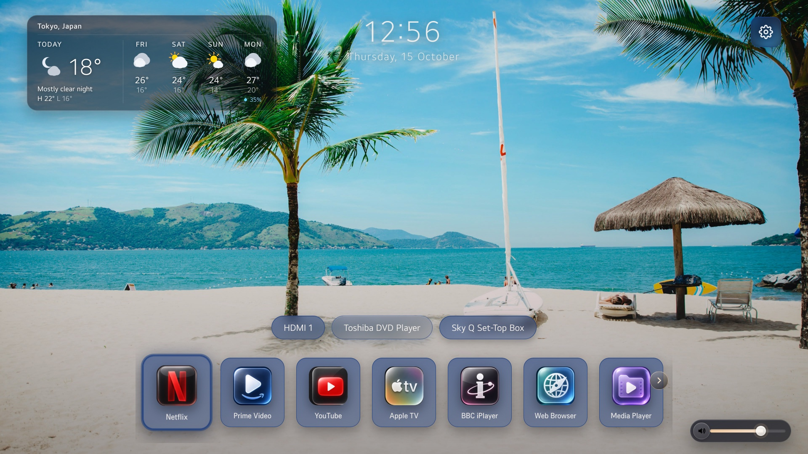

# Launch Home: Apple TV style

An Apple TV-style home screen for rooted LG webOS TVs.

This project is a fork of [Launch Home](https://github.com/gprot42/webos-launch-home) by gprot42. The Apple TV-style design comes from [webos-vibehack](https://github.com/OmkarK97/webos-vibehack) by OmkarK97, which ports [tv-vibehack](https://github.com/Gathin23/tv-vibehack) by Gathin. All of Launch Home stays: the same app, the same settings, and the same integration with the TV. See [Credits](#credits).



All the Apple TV-style screenshots come from an LG OLED C1 with webOS 6.

## What it looks like

The top row of apps is a dock, as on an Apple TV. The name of the app that you select shows in large type above the dock. Your other apps are in a grid below the dock.



The clock at the top right opens a menu. The menu shows the date, your TV inputs, Launch Home settings and TV Settings.



You set the home style in **Settings → Look → Home style**.



## Features

### Apple TV-style home screen

- **Dock and grid.** The dock is on a translucent shelf. The grid scrolls when you move down. You can show 3, 4, 5 or 6 apps in each row.
- **Recently used apps.** The dock can show the apps that you opened last. Launch Home records an app when you open it from a tile, by voice or in a different way. The dock changes when you go back to the home screen, not while you move through the tiles. You can also keep your pinned order.
- **Wide tiles.** Popular apps get 16:9 tiles. Each tile comes from the art that the app installs on webOS. Other apps show their icon on a blurred copy of the same icon.
- **Focus effects.** The selected tile becomes larger and gets a soft shadow and a light sheen. One glass frame moves between the tiles. When you point at the selected tile with the Magic Remote, the tile tilts a small amount.
- **Clock menu.** The clock is at the top right, as on an Apple TV. Press it to open the menu. The menu switches inputs and opens Launch Home settings or TV Settings. Over a photo wallpaper, the menu is frosted glass. Over an aerial video, the menu is smoked glass.
- **Your wallpaper.** The home screen shows your wallpaper behind the tiles. This includes the Apple aerial videos.
- **Optional colour glow.** A glow in the colour of the selected app can show behind the dock or across the full screen. The glow is off by default.
- **Correct local time.** If you do not select a time zone, the clock uses the time zone and offset from the TV settings. Some TVs keep their system clock on GMT, and this setting corrects the clock on those TVs.
- **webOS 6 support.** The home screen works with the Chromium 79 browser engine of webOS 6. webOS plays video on a hardware layer below the page, and the page cannot blur that layer. So the home screen does not use a blur over a video.
- **Performance mode.** In the Apple TV style, Performance mode changes only the wallpaper (smaller photos, no slow zoom) and the Settings, All apps and screensaver screens. The home screen keeps its animations.

### Classic style

Launch Home's original home screen stays available. Set **Settings → Look → Home style** to **Classic** to use it.



### Launch Home features in both styles

- Pinned apps, plus custom app tiles. You can pin any installed app by its app ID.
- **Add all apps from LG's home screen** in one step, in LG's order (Settings → Apps → Add an app). You can also select apps one at a time.
- **Number keys** (optional). Keys 1–9 open the tile that shows that number. The numbers follow your pinned order.
- HDMI and TV inputs with your own labels. You can add an input that the TV does not show.
- **TV channels.** If the TV has Live TV channels, a Channels item shows what is on now and your LG favourite channels.
- Wallpapers: built-in photos, photos from USB, online photos, or **Apple aerial videos** that stream from Apple. The package does not include the videos.
- Ambient music, with volume control from the remote.
- Weather for today and the next 4 days (Open-Meteo, no API key). The weather shows in the Classic style.
- Optional TV volume levels for Launch Home and for other apps.
- A Launch Home screensaver with a slideshow and a clock.
- **Launch on Home button.** A root watcher opens Launch Home again when the LG home screen shows.
- **Boot on TV start.** A root script opens Launch Home after power-on. It also opens Launch Home when the TV wakes from standby with Quick Start+ on.
- **Backup and restore** of all settings, to the TV and to a USB drive. See [Backup and restore](#backup-and-restore).
- **Voice assistant** (optional). See [Voice](#voice).

## Remote control

| Key | On the home screen |
| --- | --- |
| Left, Right | Move between tiles |
| Up, Down | Move between rows. Up from the dock goes to the clock. |
| OK | Open the app, or open the clock menu |
| Back | Close the menu or Settings |
| 1–9 | Open the tile with that number badge (if Number keys is on) |
| Volume, Red, Green | Change, pause or skip the ambient music |
| Blue, Channel Up | Show the next aerial video |
| Channel Down | Show the previous aerial video |

In the clock menu, Up and Down move between items. Left or Back closes the menu.

## Settings for the Apple TV style

All of these settings are in **Settings → Look → Home style**.

| Setting | Values | Default |
| --- | --- | --- |
| Layout | Dock (Apple TV style), Classic (original) | Dock |
| Dock: apps per row | 3, 4, 5, 6 | 4 |
| Dock: top row shows | Recently used, Pinned order | Recently used |
| Dock: glow in the app's colour | Off, Soft (behind the dock), Full screen | Off |

The Glass, icon size and icon layout settings apply only to the Classic style. To use the TV's own app icons instead of the wide tiles, turn off **Use Launch Home app icons** in Settings → Look → Clock & icons.

## Requirements

- An LG TV with webOS, rooted, with [Homebrew Channel](https://github.com/webosbrew/webos-homebrew-channel) and SSH.
- Root permission through Homebrew Channel. Launch Home needs root to read the full app list, to catch the Home button and to start at boot. See [Run Launch Home as root](#run-launch-home-as-root).

### Recommended tools

These projects work well with this home screen:

- **[Can I Root My TV?](https://cani.rootmy.tv/)** Use this site to root your TV. It shows the root exploit that works for your TV model and firmware version, with the instructions. Root your TV and install Homebrew Channel before you install this home screen.
- **[Glasshouse](https://github.com/rorygallagher2024/glasshouse)** Use this project to debloat your TV. It runs on the rooted TV and gives you a dashboard. Use the dashboard to remove LG's ads, stop LG's data collection, and remove apps that you do not use. It also gives privacy controls, OLED panel care and a Home Assistant bridge. With Glasshouse installed, its dashboard app gets its own tile on this home screen.

### Compatibility

| webOS version | Status | Notes |
| --- | --- | --- |
| webOS 6 (6.5.3) | Working, Apple TV style tested | LG OLED65C1PSA |
| webOS 25 (sdk ~10) | Working | Launch Home's main test TV (LG OLED55C56LB) |
| webOS 6–9 / 22–24 | Expected to work | Same Luna APIs as webOS 25 |
| webOS 5.x | Expected to work | Package with the project's own `@webos-tools/cli` |
| webOS 4.x | Working (reported) | The Home watcher and boot script use `luna-send` fallbacks for webOS 4 |

**webOS 4 notes:**

- The built-in wallpapers are in the app package. You can find them on the TV in `/media/developer/apps/usr/palm/applications/org.webosbrew.lounge.launcher/assets/backgrounds/`.
- Settings → Background → **Online URL** shows a gallery of online nature and anime photos. You can also paste an https image URL. See [docs/background-sources.md](docs/background-sources.md).
- If the Home button or Boot on start stops after an update, set the setting to off, save, set it to on, and save again.

## Install

1. Get the code and the build tools:

   ```bash
   git clone https://github.com/ferpart/webos-launch-home.git
   cd webos-launch-home
   npm install
   ```

2. Build the package and install it on the TV. On macOS, use the install script:

   ```bash
   TV_IP=192.168.0.79 ./install2tvfrommacos.sh
   ```

   Or build the package and install it with `ares-install`:

   ```bash
   npm run pack
   ares-install --device webos dist/*.ipk
   ```

The app ID is the same as Launch Home's (`org.webosbrew.lounge.launcher`). If Launch Home is on your TV, this package replaces it and keeps your settings.

`npm run pack` uses the project's own `@webos-tools/cli`. It rejects files with the date `1970-01-01`. The older `@webosose/ares-cli` writes that date with Node.js 22 or later, and some webOS 5 TVs do not install those packages.

## Run Launch Home as root

Retail webOS gives the full list of installed apps only to root clients. A normal web app sees only its own launch points. So **Scan for apps** finds nothing unless Launch Home has root permission. On a rooted TV, the Homebrew Channel root service (`luna://org.webosbrew.hbchannel.service/exec`) gives this permission.

The Home button watcher and Boot on TV start also use the root service. They install scripts in `/var/lib/webosbrew/init.d/`, and the TV runs these scripts at boot. With **Quick Start+** on, the power button only puts the TV into standby. So the scripts do not run again until a full restart. To solve this, Boot on TV start stays in the background and opens Launch Home each time the TV wakes. To make each power-on a full boot, set Quick Start+ to off in General → Devices → TV Management.

1. Get root permission. Connect to the TV with SSH, and run the Homebrew Channel elevation script:

   ```bash
   ssh root@TV_IP
   /media/developer/apps/usr/palm/services/org.webosbrew.hbchannel.service/elevate-service
   ```

2. Keep root permission after reboots and app updates. Copy the Homebrew Channel startup script to the boot location:

   ```bash
   cp /media/developer/apps/usr/palm/services/org.webosbrew.hbchannel.service/startup.sh \
      /var/lib/webosbrew/startup.sh
   ```

   This file is outside the app folder. An update of Launch Home does not remove it.

3. (Optional) Get root permission again at each boot. Homebrew Channel runs each executable file in `/var/lib/webosbrew/init.d` as root at boot. Add this file:

   ```bash
   mkdir -p /var/lib/webosbrew/init.d
   cat > /var/lib/webosbrew/init.d/30-lounge-elevate <<'EOF'
   #!/bin/sh
   /media/developer/apps/usr/palm/services/org.webosbrew.hbchannel.service/elevate-service
   EOF
   chmod +x /var/lib/webosbrew/init.d/30-lounge-elevate
   ```

> **Note:** A TV firmware update can remove root. If app scanning stops after a firmware update, root the TV again, install Homebrew Channel again, and do steps 1 and 2 again.

## Voice

Launch Home has its own voice assistant for the **Voice** button of the Magic Remote. The assistant is **off by default**.

To use it:

1. Go to **Settings → AI Voice → Voice assistant** and set it to on. This needs root through Homebrew Channel.
2. Add an xAI (Grok) key, sign in with SuperGrok, or add a Gemini or OpenRouter key.
3. Press Save.

**What you can say:**

- Open an app ("open Netflix").
- Change or mute the volume.
- Change the channel.
- Switch the input ("HDMI 2").
- Turn captions on or off.
- Set a sleep timer.
- Turn off the TV.
- Ask for the weather.

The assistant answers other questions on the screen and speaks the answer.

**When the assistant is on, Launch Home:**

- Shows a small microphone badge while it listens.
- Opens the apps that you ask for from the foreground. This is the reliable way to open native apps such as Prime Video.
- Runs its daemon (`voice/daemon`, Python 3, as root) from the app folder. Launch Home restarts the daemon after updates and starts it at power-on (`/var/lib/webosbrew/init.d/45-launch-home-voice`).
- Installs a small hidden app, **Launch Home Voice** (`org.webosbrew.lounge.voice`). This app shows the question and the answer, and plays the spoken reply.

When you set the assistant to off, Launch Home stops the daemon and removes the boot script and the voice app. The Voice button then goes back to LG. Your settings and SuperGrok sign-in stay in `/home/root/.config/launch-home-voice`. The log is in `/tmp/launch-home-voice.log`.

**Other voice assistants.** The assistant uses its own port (`127.0.0.1:8678`), files, settings and app IDs. Launch Home talks only to a voice service that identifies itself as its own. It does not stop or change a different assistant, such as VoxRelay. If VoxRelay runs or is on the TV, the AI Voice tab shows a warning, because both assistants would answer the Voice button.

**Interface between Launch Home and the daemon.** Launch Home connects to `ws://127.0.0.1:8678`. It first sends `{"type": "hello", "params": {"role": "launcher"}}`. It continues only if the reply names `launch-home-voice`. The daemon then sends JSON events in the form `{"event": …, "payload": …}`:

| Event | Payload | What Launch Home does |
|---|---|---|
| `sessionStarted`, `sessionCatchup` | `listening: true` (or `early: true` / `reason: "button_press"`) | Shows the microphone badge |
| `listeningEnded`, `sessionEnded`, `error` | — | Hides the microphone badge |
| `appLaunch` | `id`, `ids[]`, `spoken` | Opens that app |
| `transcriptFinal` | `text` | Finds "open …" or "launch …" in the dock and opens the app |

The AI Voice settings use requests in the form `{"type": …, "params": …, "id": …}`. The daemon answers with `{"event": "configResult", "id", "ok", "result"|"error"}`. The requests are:

- `getConfig`: the values, plus `options` (the choices for each picker)
- `setConfig`
- `getStatus`
- SuperGrok sign-in: `startSuperGrokLogin`, `cancelSuperGrokLogin`, `signOutSuperGrok` and `importSuperGrokAuth`

## Backup and restore

Go to **Settings → Tools → Backup & restore**. This needs root through Homebrew Channel.

- **Back up settings** saves all your Launch Home settings to two locations:
  - On the TV: `/home/root/.config/launch-home/settings-backup.json`
  - On a USB drive, if you connect one: `lounge/launch-home-settings.json`

  The backup does not include voice keys or the SuperGrok sign-in. They stay in `/home/root/.config/launch-home-voice`.
- **Restore settings** shows all the backups that it finds. This includes your backups and the copies that Launch Home makes by itself in `/home/root/.config/launch-home/auto/`. Launch Home makes one copy before each restore, and one copy before each of the last three updates. Select a backup and press **Restore this backup**.

A backup from one version of Launch Home can go into a different version:

- Each backup file records the Launch Home version and the settings layout version that made it.
- **Older backup:** Launch Home updates its settings with the same steps that it uses for an app update.
- **Newer backup:** Launch Home keeps the settings that this version does not know, but does not use them.
- If a setting does not fit (for example, a number where this version expects text), Launch Home keeps your current value. After the restore, the status line lists each setting that it skipped or did not use.
- The voice assistant's on/off setting belongs to each TV. A restore does not change it.
- To undo a restore, restore the copy marked **before your last restore**. To go back to an older version of Launch Home, restore the copy marked **before updating** from that version.

## Credits

This project uses the work of these people and projects:

- **[Launch Home](https://github.com/gprot42/webos-launch-home)** by gprot42 and its contributors. This project is a fork of Launch Home. The app, its settings, and its integration with the TV are their work.
- **[webos-vibehack](https://github.com/OmkarK97/webos-vibehack)** by OmkarK97, and **[tv-vibehack](https://github.com/Gathin23/tv-vibehack)** by Gathin. The dock and grid layout, the glass frame, the colour glow and the icon colour sampling come from these projects.
- **[Glasshouse](https://github.com/rorygallagher2024/glasshouse)** by Rory Gallagher. Its logo is the art for its tile.
- **[Outfit](https://github.com/Outfitio/Outfit-Fonts)**, the typeface of the Apple TV style, by The Outfit Project Authors.

This project is not made by, or connected to, Apple or LG. "Apple TV" names the design style only.

## License

This project uses the [MIT License](LICENSE), the same as Launch Home:

- The `LICENSE` file keeps the original Launch Home copyright notice. MIT requires this notice in all copies. The file also adds a copyright line for the Apple TV-style changes.
- The code from webos-vibehack and tv-vibehack, and the Glasshouse logo, are also under the MIT License. Their notices are in [THIRD-PARTY-NOTICES.md](THIRD-PARTY-NOTICES.md).
- The Outfit typeface uses the SIL Open Font License 1.1. See [assets/fonts/OFL.txt](assets/fonts/OFL.txt).
- App names, logos and tile art belong to their owners. This project uses them only to label the apps.
- The built-in wallpapers, music and app icons keep their own terms. For the online wallpapers, see [docs/background-sources.md](docs/background-sources.md).
